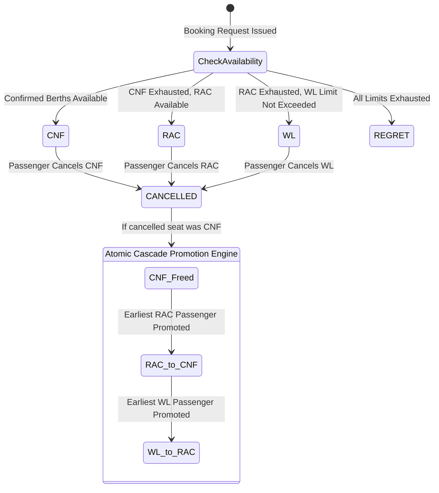

# Deep Dive: Operating System Concepts & Relational Architecture

**Project:** Operating System-Based Train Ticket Reservation System  
**Station Hub:** Durgapur, West Bengal (Eastern Railway)  
**Implementation:** Modular C (C99/C11) & Relational SQL

---

## 1. Operating System Concepts Implemented

### 1.1 Process & Thread Concurrency Model
The system supports both single-node operation and distributed multi-counter client-server simulation:
- **Central Daemon (`server.c`):** Utilizes POSIX Berkeley sockets (`AF_INET`, `SOCK_STREAM`) listening on a dedicated port. For every incoming terminal connection, a new worker thread is spawned via `pthread_create()` with `pthread_detach()` to handle asynchronous I/O independently without blocking the master listening socket.
- **Worker Simulation (`concurrency.c`):** Simulates $N$ PRS counters across Eastern Railway (e.g. Durgapur Counters 1 & 2, Howrah Counters, Asansol Terminal, IRCTC Portal). Each thread issues concurrent reservation transactions targeting the identical train, date, and coach inventory.

```
       [Client Terminal 1]    [Client Terminal 2]    [Client Terminal 3]
       (Durgapur Counter 1)   (Howrah Counter 1)     (IRCTC Web Portal)
               │                      │                      │
               └──────────────┬───────┴──────────────┬───────┘
                              │ TCP Sockets (9090)   │
                              ▼                      ▼
               ┌──────────────────────────────────────────────┐
               │         Central PRS Daemon (Master)          │
               │            pthread_create / detach           │
               └──────────────────────┬───────────────────────┘
                                      │
            ┌─────────────────────────┼─────────────────────────┐
            ▼                         ▼                         ▼
      [Worker Thread 1]         [Worker Thread 2]         [Worker Thread 3]
            │                         │                         │
            └──────────────┬──────────┴──────────┬──────────────┘
                           │ Critical Section    │
                           ▼                     ▼
               ┌──────────────────────────────────────────────┐
               │    Seat Inventory Mutex (pthread_mutex_t)    │
               │   Advisory Record File Lock (fcntl F_SETLKW) │
               └──────────────────────┬───────────────────────┘
                                      │
                                      ▼
               ┌──────────────────────────────────────────────┐
               │  Write-Ahead Transaction Log (open / fsync)  │
               └──────────────────────────────────────────────┘
```

---

### 1.2 Synchronization Primitives & Critical Sections
A core challenge in railway reservation systems is the **Ticket Allocation Race Condition**: if two counters query 1 remaining seat simultaneously and both issue a booking, naive systems cause double-allocation (overselling).

We resolve this through a multi-tier synchronization strategy:
1. **Seat Inventory Mutex (`pthread_mutex_t seat_mutex`):** Protects the critical section during seat discovery, berth preference assignment, and status designation (CNF, RAC, WL).
2. **Read-Write Locks (`pthread_rwlock_t inventory_rwlock`):** Permits hundreds of concurrent readers (`pthread_rwlock_rdlock`) to inspect timetables and seat counts simultaneously, while escalating to exclusive lock (`pthread_rwlock_wrlock`) during booking or cancellation.
3. **Unique PNR Generation Mutex (`pthread_mutex_t pnr_mutex`):** Ensures that parallel counters generating 10-digit PNRs never produce duplicate keys.
4. **Audit Trail Mutex (`pthread_mutex_t audit_mutex`):** Ensures serialized, non-interleaved log writes to disk.

---

### 1.3 Operating System File Handling & Durability Mechanisms
The system implements low-level OS file descriptors rather than relying strictly on buffered high-level I/O:
- **Write-Ahead Logging (WAL):** Every state change (`CREATE_USER`, `CREATE_BOOKING`, `CANCEL_PNR`, `RAC_PROMOTION`) is appended to `data/transactions.wal` using:
  ```c
  int fd = open("data/transactions.wal", O_WRONLY | O_CREAT | O_APPEND, 0644);
  write(fd, log_buffer, len);
  fsync(fd); /* Forces dirty OS kernel buffer cache flush to non-volatile disk */
  close(fd);
  ```
- **OS Advisory Record Locking (`fcntl`):** To guarantee safe multi-process execution across separate terminal processes accessing shared binary files, the system employs POSIX record-level advisory locking:
  ```c
  struct flock fl;
  fl.l_type = exclusive ? F_WRLCK : F_RDLCK;
  fl.l_whence = SEEK_SET;
  fl.l_start = 0;
  fl.l_len = 0; /* Entire file */
  fcntl(fd, F_SETLKW, &fl); /* Block until lock is acquired */
  ```
- **Graceful Signal Handling:** Registers `SIGINT` and `SIGTERM` handlers (`main.c`) to intercept abrupt terminations (e.g. `Ctrl+C` or `kill`), systematically flushing in-memory dirty pages to binary records and releasing file locks cleanly.

---

## 2. Dynamic Fare Computation Engine

### 2.1 Distance & Class Multiplier Matrix
Fare computation is parameterized by route distance and class ergonomics:
$$\text{Base Fare} = \max\left(\text{MinFare}_{\text{class}}, (\text{Distance}_{\text{km}} \times \text{Rate}_{\text{class}}) + \text{SuperfastCharge}\right)$$

| Class Code | Class Name | Rate / km (Rs) | Min Fare (Rs) | Superfast Charge | GST Rate |
|---|---|---|---|---|---|
| **1A** | AC First Class | 3.60 | 500.00 | 75.00 | 5% |
| **2A** | AC 2-Tier | 2.40 | 350.00 | 45.00 | 5% |
| **3A** | AC 3-Tier | 1.65 | 250.00 | 45.00 | 5% |
| **CC** | AC Chair Car | 1.45 | 200.00 | 45.00 | 5% |
| **SL** | Sleeper Class | 0.65 | 120.00 | 30.00 | 0% |
| **2S** | Second Sitting | 0.35 | 50.00 | 15.00 | 0% |

### 2.2 Dynamic Demand Surge Curve
To simulate modern yield management (dynamic pricing), a continuous occupancy ratio $\rho = \frac{\text{Booked Seats}}{\text{Total Capacity}}$ determines surge surcharge:
$$\text{Surge Multiplier } M_s = \begin{cases} 
1.35 & \text{if } \rho \ge 0.85 \quad (+35\% \text{ peak surge}) \\
1.20 & \text{if } 0.70 \le \rho < 0.85 \quad (+20\% \text{ high surge}) \\
1.10 & \text{if } 0.50 \le \rho < 0.70 \quad (+10\% \text{ moderate surge}) \\
1.00 & \text{if } \rho < 0.50 \quad (\text{standard fare})
\end{cases}$$

### 2.3 Dynamic Cancellation Refund Matrix
Refund amounts dynamically adapt according to the notice window prior to scheduled departure time:
1. **$\Delta t \ge 48 \text{ hours}$:** Flat clerkage fee deducted (Rs. 240 for 1A, Rs. 200 for 2A, Rs. 180 for 3A/CC, Rs. 120 for SL, Rs. 60 for 2S).
2. **$12 \text{ hours} \le \Delta t < 48 \text{ hours}$:** 25% of gross fare deducted (subject to minimum clerkage).
3. **$4 \text{ hours} \le \Delta t < 12 \text{ hours}$:** 50% of gross fare deducted.
4. **$\Delta t < 4 \text{ hours}$ (Chart Prepared):** 0% refund (100% forfeiture).
5. **RAC / Waiting List Tickets:** Flat clerkage fee deducted (Rs. 60/80) irrespective of time, full remainder refunded.

---

## 3. Cascade Promotion Queue State Machine



When a confirmed passenger cancels:
1. The allocated coach, seat number, and berth type are preserved.
2. The system executes a FIFO query across all bookings for that train/date/class with `status == STATUS_RAC`.
3. The first candidate is atomically promoted to `STATUS_CNF`, receiving the exact vacated coach and seat.
4. Next, the first candidate with `status == STATUS_WL` is promoted to `STATUS_RAC`.
5. An audit trail entry is logged with timestamp, user ID, and PNR.

---

## 4. Relational Database Modules (3NF Normalization)

The database schema (`sql/schema.sql`) adheres to **Third Normal Form (3NF)**:
- **`users`:** Role-based identity management (Admin, Agent, Passenger, TTE).
- **`stations`:** Railway network vertices (Station codes, divisions, platforms).
- **`trains`:** Physical rolling stock specifications and base speed.
- **`route_stops`:** Directed path edges with arrival/departure timestamps and cumulative distance from source.
- **`coaches` & `seat_inventory`:** Berth-level granularity for coach layouts.
- **`bookings`:** PNR-indexed master ledger storing financial totals, quota, and travel class.
- **`passengers`:** 1-to-N relation mapping individual travelers, allocated berths, concessions, and individual fares.
- **`cancellations`:** Refund records and administrative reasons.
- **`transactions`:** Double-entry payment ledger tracking counter cash, card, and refunds.
- **`audit_logs`:** Non-repudiation log tracking user actions, terminal IDs, and timestamps.
