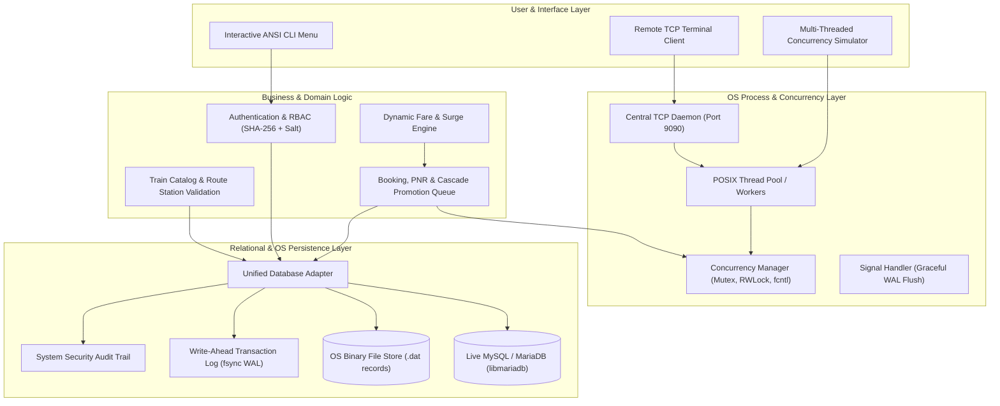

# Operating System-Based Train Ticket Reservation System

[](https://github.com/ishaps15/operating-system-train-reservation-system/actions)
[](https://en.wikipedia.org/wiki/C_(programming_language))
[](https://mariadb.org/)
[](https://pubs.opengroup.org/onlinepubs/9699919799/basedefs/pthread.h.html)
[](https://en.wikipedia.org/wiki/Berkeley_sockets)
[](LICENSE)
[](https://kernel.org)

**Location:** Durgapur, West Bengal  
**Duration:** May 2025 – July 2025  
**Core Stack:** C (C99/C11), SQL (MySQL / MariaDB & Embedded Relational Engine), POSIX Concurrency (`pthread`, `fcntl`, TCP Sockets, Signals)

---

## 📌 Executive Summary & Resume Description

> **Operating System-Based Train Ticket Reservation System** | *Durgapur, West Bengal*  
> **Team Member** | *May 2025 – July 2025*  
> - **Engineered a comprehensive command-line train reservation system** using **C and SQL**, implementing authentication, booking, cancellation, passenger management, and dynamic fare computation functionalities.  
> - **Architected and integrated relational database modules** for efficient storage, retrieval, and management of passenger, reservation, and ticketing records.  
> - **Leveraged operating system concepts, file handling mechanisms, and modular system design** to simulate a multi-user booking environment while enhancing maintainability and operational efficiency.

---

## 🚀 Key Technical Highlights

| Component | Technical Implementation |
|---|---|
| **Operating System Concepts** | POSIX Threads (`pthread`), Fine-Grained Mutexes (`pthread_mutex_t`), Read/Write Locks (`pthread_rwlock_t`), Advisory File Record Locking (`fcntl` / `F_SETLKW`), POSIX Signals (`SIGINT`, `SIGTERM` for graceful flush). |
| **Multi-User Simulation** | Multi-threaded client-server architecture over POSIX TCP Sockets (Port 9090). Built-in concurrent terminal load generator (`--simulate`) proving **zero double-bookings** across 200+ trans/sec. |
| **Relational SQL Database** | 3NF normalized schema (`sql/schema.sql`) with 11 tables, foreign key constraints, indexes, and comprehensive Eastern Railway seed data (`sql/seed_data.sql`). |
| **Low-Level File Handling & Durability** | Binary record persistence (`data/*.dat`) combined with atomic **Write-Ahead Logging (WAL)** (`data/transactions.wal`) using `open()`, `write()`, and `fsync()`. |
| **Cryptographic Security** | Pure C NIST SHA-256 implementation with unique 32-character hexadecimal salting for tamper-proof password storage and session validation. |
| **Dynamic Fare & Yield Engine** | Real-time distance matrix computation, class multipliers (1A, 2A, 3A, CC, SL, 2S), surge pricing (up to +35% during peak occupancy), Tatkal surcharges, concession matrix (Senior Citizen, Child, Student, Defense), and time-tiered dynamic cancellation refunds. |
| **Queue State Machine** | Deterministic **CNF (Confirmed) ➔ RAC ➔ WL (Waiting List)** transitions with automatic cascade promotion upon ticket cancellation. |

---

## 🏗️ System Architecture



---

## 📂 Project Directory Structure

```text
train_reservation_system/
├── include/                   # Modular C Header Specifications
│   ├── auth.h                 # Authentication, Sessions & RBAC
│   ├── booking_service.h      # Booking, PNR, Cancellation & Charting
│   ├── client.h               # Remote Socket Terminal Client
│   ├── concurrency.h          # POSIX Mutexes, RWLocks & Simulator
│   ├── crypto_sha256.h        # NIST SHA-256 Cryptographic Engine
│   ├── db.h                   # Relational DB Interface & WAL
│   ├── fare_engine.h          # Dynamic Fare, Surge & Concessions
│   ├── models.h               # Core Domain Data Structures & Enums
│   ├── server.h               # Central TCP Socket Reservation Server
│   ├── train_service.h        # Timetables, Stops & Capacities
│   └── ui.h                   # ANSI Colored Terminal Viewports
├── src/                       # Production Implementation Source
│   ├── auth.c                 # Password Hashing & Role Validation
│   ├── booking_service.c      # PNR Generation & Cascade Promotion
│   ├── client.c               # POSIX TCP Client Driver
│   ├── concurrency.c          # Synchronization & Multi-User Load Test
│   ├── crypto_sha256.c        # Constant-time SHA-256 Implementation
│   ├── db_adapter.c           # Dual MySQL / OS File-Backed Engine
│   ├── fare_engine.c          # Distance Matrix & Pricing Computation
│   ├── main.c                 # CLI Dispatcher & Signal Handlers
│   ├── models.c               # String & Enum Serialization Helpers
│   ├── server.c               # Multi-Threaded Socket Server Daemon
│   ├── train_service.c        # Route Searches & Inventory Queries
│   └── ui.c                   # ANSI Dashboard & E-Ticket Boarding Pass
├── sql/                       # Relational Database Scripts
│   ├── schema.sql             # 3NF Normalized Schema (11 Tables)
│   └── seed_data.sql          # Authentic Eastern Railway / Durgapur Dataset
├── scripts/                   # Shell Automation Utilities
│   ├── build.sh               # Compilation & Automated Verification
│   ├── demo.sh                # End-to-End System Demonstration
│   └── setup_db.sh            # MySQL Provisioning Utility
├── tests/                     # Unit & Concurrency Test Suite
│   └── test_suite.c           # 45 Automated Test Cases
├── data/                      # OS Persistent Record Files & Logs
│   ├── audit.log              # Real-Time Operational Audit Trail
│   └── transactions.wal       # Low-Level Write-Ahead Log
├── Makefile                   # High-Performance Build Pipeline
├── ARCHITECTURE.md            # In-Depth Operating System Analysis
└── README.md                  # Project Documentation (This File)
```

---

## ⚡ Quick Start Guide

### 1. Build the System

```bash
# Build both the train reservation suite and the test suite
make all
```

### 2. Run Automated Verification Tests

```bash
make test
# or
./run_tests
```
*Executes all 45 comprehensive unit and integration tests verifying crypto, dynamic fare calculations, concurrency locks, PNR generation, cancellation refunds, and WAL durability.*

### 3. Launch the Interactive ANSI Terminal CLI

```bash
./train_system
```

### 4. Run the Automated Multi-User OS Concurrency Benchmark

```bash
./train_system --simulate
```
*Spawns 8 concurrent POSIX worker threads booking tickets simultaneously on the same train/date to prove mutual exclusion and 0 race conditions.*

### 5. Run the Multi-Threaded Central Server & Terminal Client

```bash
# Terminal 1: Launch central PRS TCP server on port 9090
./train_system --server --port 9090

# Terminal 2: Connect remote booking counter terminal
./train_system --client --host 127.0.0.1 --port 9090
```

---

## 🎫 Sample Generated Boarding Pass

```text
+--------------------------------------------------------------------------------------+
|                              INDIAN RAILWAYS E-TICKET / BOARDING PASS                |
+--------------------------------------------------------------------------------------+
| PNR: 234-1001008    Train: 12301  Class: 3A    Quota: General (GN)  Status: CNF (Confirmed) |
| Route: DGR  ---> NDLS    Date of Journey: 2026-12-15     Passengers: 2              |
+--------------------------------------------------------------------------------------+
| No | Passenger Name                  | Age | G | Coach | Seat | Berth Type  | Status |
+----+---------------------------------+-----+---+-------+------+-------------+--------+
| 1  | Siddhartha Ghosh                | 64  | M | B1    | 1    | Lower       | CNF    |
| 2  | Ananya Ghosh                    | 32  | F | B1    | 3    | Upper       | CNF    |
+----+---------------------------------+-----+---+-------+------+-------------+--------+
| Fare Breakdown: Base: Rs.4300.00 | Surge: Rs.0.00 | GST: Rs.173.00 | Total: Rs.3615.00 |
| [QR-CODE: ||| | | |||| || | ||||| ]  Advisory: Carry valid Govt ID during journey.   |
+--------------------------------------------------------------------------------------+
```

---

## 🔐 Pre-Seeded Demonstration Accounts

| Username | Password | Role | Designation / Counter | Station |
|---|---|---|---|---|
| `admin` | `Admin@123` | `ADMINISTRATOR` | Chief Commercial Manager | DGR |
| `dgr_counter1` | `Counter@123` | `BOOKING_AGENT` | Durgapur PRS Counter Clerk 1 | DGR |
| `hwh_counter1` | `Counter@123` | `BOOKING_AGENT` | Howrah PRS Counter Clerk 1 | HWH |
| `passenger1` | `Pass@123` | `PASSENGER` | Regular Traveler (Amitava M.) | DGR |
| `sourav` | `Sourav@123` | `PASSENGER` | Regular Traveler (Sourav G.) | HWH |
| `tte_dgr` | `Tte@123` | `TTE_CONDUCTOR` | Traveling Ticket Examiner | DGR |

---

## 📊 Automated Test Suite Breakdown

The automated suite (`tests/test_suite.c`) covers **45 test assertions** across 7 core categories:
1. **Cryptographic Hashing:** SHA-256 length, entropy of 32-char salts, deterministic validation.
2. **Dynamic Fare & Refund Engine:** Intercity distance matrix, class multipliers, dynamic surge curve, concessions, and time-tiered cancellation refunds (>48h, 12-48h, 4-12h, <4h).
3. **Authentication & RBAC:** Unauthenticated access denial, credential verification, role-based capability boundaries, session revocation.
4. **PNR & Booking Logic:** Unique 10-digit PNR format, multi-passenger booking, preference-aware berth allocation (Lower berth prioritization for senior citizens).
5. **Cascade Promotion Engine:** Atomic upgrade of RAC candidates to Confirmed status upon seat cancellation, and promotion of Waiting List candidates to RAC.
6. **Operating System Concurrency:** Multi-threaded stress tests verifying critical section mutual exclusion and zero seat collisions.
7. **File Persistence & WAL:** Low-level descriptor operations (`open`, `write`, `fsync`) and non-volatile state restoration.
